# Lesson 13 — Review and next steps

## Goal

Look back over the whole loop — empty folder to live site — and state what was
actually produced versus what was substituted.

## Result

### The loop, end to end

```mermaid
flowchart LR
  A[Empty folder] --> B[index.html]
  B --> C[smoke.js 35 checks]
  C --> D[AGENTS.md]
  D --> E[Public repo]
  E --> F[Issues #1-3]
  F --> G[Worktree + shuffle]
  G --> H[Plan + personal best]
  H --> I[PR review + merge]
  I --> J[Weekly triage automation]
  J --> K[Pages deploy]
  K --> L[Live site]
```

### Delivered

| Artifact | Evidence |
| --- | --- |
| Working quiz, single file, zero deps | `space-quiz/index.html` |
| 35 core checks | `cd tests && node smoke.js` → `35/35 checks passed` |
| 22 persistence checks | `cd tests && node best.js` → `22/22 checks passed` |
| CI on every push/PR | `.github/workflows/ci.yml` |
| Agent rules | `AGENTS.md` |
| Human docs | `README.md` |
| Public repo | github.com/HobaiRiku/space-quiz |
| Merged PRs | #4 shuffle, #5 personal best + README, #6 Pages, #7 docs |
| Automation | weekly *Issue triage*, Autopilot, model Auto |
| **Live site** | **https://hobairiku.github.io/space-quiz/ — HTTP 200** |

### Honestly substituted

| Lesson | Why | Cost |
| --- | --- | --- |
| 2 browser preview | `open_canvas` broken (`input is not of type object`) | No visual/layout check |
| 8 Copilot code review | Reviewer bot unavailable on this plan | Human-equivalent diff review instead |
| 9 automation creation | API requires `host_id`, none exposed | Drafted in editor for one-click confirm |
| 10 `/remote` | CLI session has no app front end | Optional lesson; PR workflow covers reviewability |
| 11 Canvas | Extension install is an app-store action | Manual's documented issue-based fallback |

None of these blocked a deliverable. Each is recorded in its own lesson log with
the failure message quoted, because a log that only records successes is a
brochure, not a record.

### What the process caught

Three defects that would have shipped silently:

1. A **wrong test expectation** (9/10 asserted as 10/10) — found on first run.
2. **Broken test paths** after moving `tests/` into the repo — found by CI.
3. **Modulo bias** in rejection sampling (`0xffffffff` vs `2 ** 32`) — found by
   self-review when Copilot review was unavailable.

The third is the interesting one: the bug is invisible at runtime (a shuffle is a
shuffle) and only shows up if you read the arithmetic. That is the argument for
the review step existing at all.

### Next steps

- **Issue #3, difficulty selector** — the one open item. Filtering the pool needs
  a per-question `difficulty` field and a deck builder that respects it; the
  existing `buildDeck()` is the natural seam.
- **Make the automation real** — click **Create and run** in the editor so the
  weekly triage stops being a draft.
- **Cover what jsdom cannot** — a real-browser run (Playwright) would catch
  layout and animation regressions the DOM harness is blind to.
- **Restore the accessibility guardrail in CI** — the checks assert ARIA
  attributes exist, but nothing fails the build if a future change removes a
  focus trap or drops the reduced-motion block.

### Takeaway

The manual's real subject is not the quiz. It is that each step leaves an artifact
that a stranger can verify: a test they can run, a workflow they can read, a URL
they can open, a PR they can diff. Everything in `workshop-logs/` is written to
that standard.